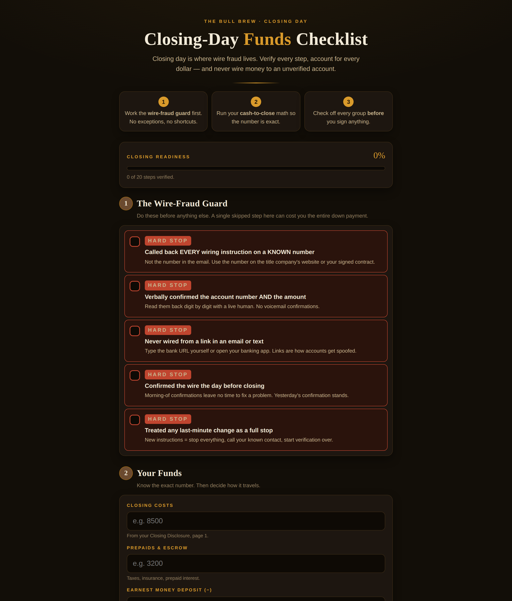

# Closing-Day Funds Checklist

**Live:** https://thebullbrew.github.io/closing-day-checklist/

Closing day is where wire fraud lives. This is the checklist + fraud guard for homebuyers: every step verified, every dollar accounted for, and a hard stop on wiring money to an unverified account.

## What it does

- **The Wire-Fraud Guard** — five hard-stop verifications: call back every wiring instruction on a *known* number (never the one in the email), verbally confirm account + amount digit by digit, never wire from a link, confirm the day before closing, and treat any last-minute change as a full stop.
- **Cash-to-close calculator** — closing costs + prepaids − earnest money − seller credits = the exact number to bring.
- **Wire vs. cashier's check helper** — three questions, one verdict.
- **Documents** — what to bring, what to sign, what to photograph.
- **Final walkthrough** — what to verify before you sit at the signing table.
- **Five classic wire-fraud tells** in plain English, so you recognize the script.
- Progress bar, persistent checkboxes, one-tap reset. Everything in `localStorage`; works offline as a PWA.

## The method

Wire fraud isn't sophisticated — it's urgent. The entire guard is built on one rule: **slow is safe**. Every hard stop forces a human callback on a number you already trust. The money math is just as strict: if the cash-to-close number isn't exact, you don't go.

## Run it

No build step. Open `docs/index.html` in any browser, or serve the `docs/` folder statically. Installable as a PWA (manifest + service worker included).

Built with JavaScript. Part of [The Bull Brew](https://github.com/thebullbrew) daily finance & real-estate tool series.
